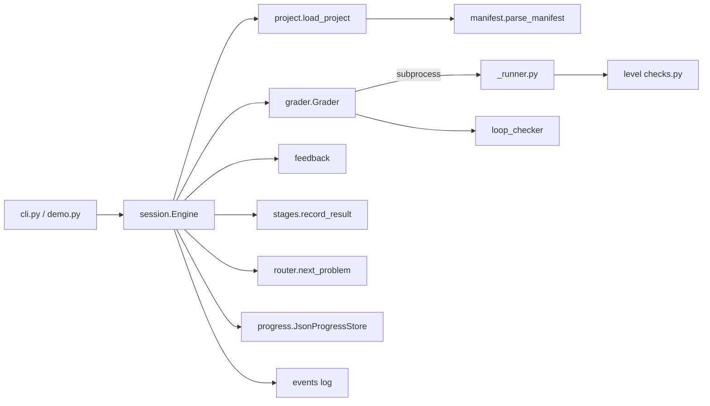
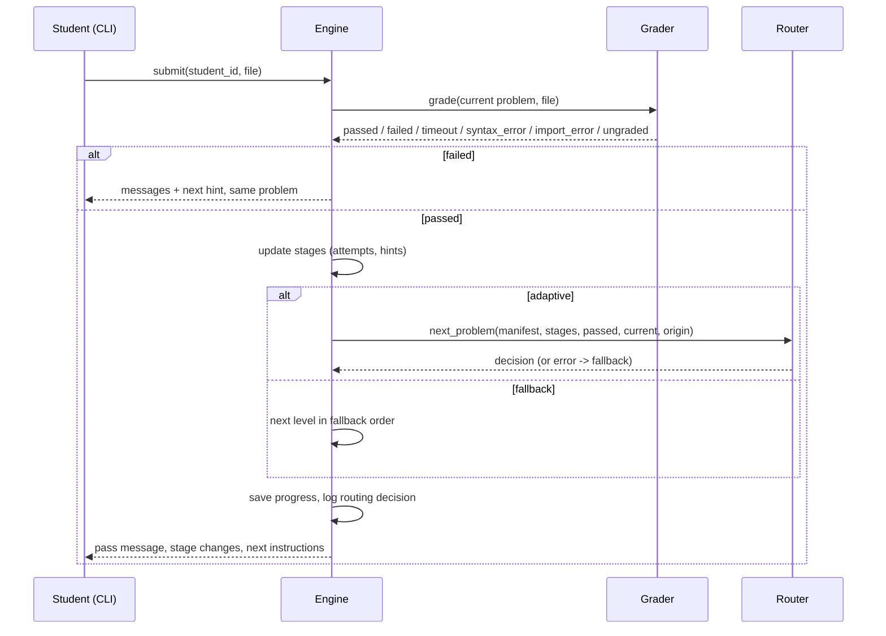
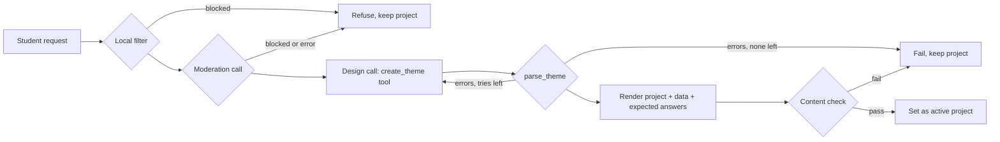

# Design Document: Weather Station Adaptive Lesson (Demo Slice)

## Overview

This design covers the **demo slice** of the requirements: a Python engine that loads a project folder, grades code submissions in a separate process, gives feedback and hints, tracks a stage per concept, routes students between levels and practice problems, falls back to a fixed level order on failure, and saves progress between sessions. It ships with Project 1, the Weather Station Project.

The demo runs locally with no cloud calls and no third-party packages beyond PyYAML.

### In scope (requirements covered)

| Requirement | Coverage |
|---|---|
| 1 Project folder and loading | Full |
| 2 Manifest parsing and printing | Full |
| 3 Synthetic dataset | Full |
| 4–7 Levels 1–4 | Full |
| 8 Reference solution and expected values | Full (property check samples date ranges, see Testing) |
| 9 Running student code safely | Full |
| 13 Feedback and hints | Full |
| 14 Stage tracking | Full |
| 15 Cross-session progress | Full |
| 16 Adaptive routing | Full |
| 17 Fallback path | Full, except criterion 2 (needs the Rubric_Grader) |
| 18 Student progress view | Full |
| 19 Privacy | Criteria 1–3 and 6. Criteria 4, 5, and 7 concern model requests and come with the Rubric_Grader |

### Deferred to the next slice

Requirement 10 (rubric grading), 11 (benchmark), and 12 (content filter). The engine leaves a place for them: a written-prompt step after a code level, graded through a `ModelProvider` interface. No written prompts are authored in Project 1 yet.

### Decisions that differ from or refine the requirements

1. **Python 3.9 compatible.** The machine has Python 3.9.25. The code avoids 3.10+ syntax, so it also runs on 3.11.
2. **Level checks are plain Python check functions, not pytest.** pytest is not installed, and a small runner gives one plain-language message per failed check, which Requirement 13.1 needs. Engine unit tests use the standard-library `unittest`. Property tests use seeded `random` instead of Hypothesis. This keeps the demo free of installs.
3. **A "graded result" for stage tracking is the outcome when a problem is passed.** Its attempt count and hints used are measured at that point. Failed attempts are counted, but they don't trigger a stage update by themselves.
4. **Project 1 sets `streak_length: 1`.** Each concept has one level, so a streak of 3 would send every student to practice problems and nothing would adapt. The engine default stays 3 (Requirement 2.4).
5. **Syntax and import errors give the next unused hint**, following Requirement 13.2. On a student's first failure this is the first hint, which also satisfies Requirement 9.4.
6. **Grader infrastructure failure keeps the student on the same problem.** The result is ungraded, stages are unchanged, and the instructions stay available (Requirement 9.6). The student is not moved ahead, because Requirement 17.3 only advances after a pass.
7. **An unreadable progress record is moved to `<name>.corrupt-<timestamp>.json`** before the new record is saved. Its contents are kept unchanged (Requirement 15.6).
8. **Empty-input `max_temp_c` is `null`** (`parameters.empty_max_temp_c` in the manifest).

## Architecture



Submission flow:



## Components and Interfaces

### Repository layout

```
engine/
  manifest.py       Manifest dataclasses, parse_manifest, print_manifest
  project.py        load_project -> Project
  grader.py         Grader.grade(problem, path) -> GradeResult
  _runner.py        subprocess entry point; runs checks, writes JSON result
  checklib.py       expect(), helpers shared by checks
  loop_checker.py   find_loop_problems(source, function_name)
  feedback.py       failure messages, hint selection
  stages.py         ConceptState, record_result
  router.py         Decision, next_problem
  progress.py       ProgressRecord, ProgressStore, JsonProgressStore
  events.py         JSONL event log
  session.py        Engine (orchestration, fallback)
  content.py        generate_expected, check_content
  cli.py            command-line interface
  demo.py           scripted three-student demo
projects/weather-station/
  manifest.yaml
  starter.py
  dataset/generate.py, seed.txt
  levels/level-1..level-4/{instructions.md, hints.yaml, checks.py}
  practice/{db-count, temp-band, rainy-days}/{instructions.md, hints.yaml, checks.py}
  reference/solution.py, independent_checker.py, expected_reports.json
tests/              unittest suites
```

### Manifest (`manifest.yaml`)

```yaml
title: Weather Station Project
streak_length: 1
concepts:
  - {id: database_retrieval, name: Database Retrieval}
  - {id: conditionals, name: Conditionals}
  - {id: loops, name: Loops}
  - {id: functions, name: Functions}
stage_criteria:          # a passing result counts toward Stage N if it meets criterion N
  1: {max_attempts: 3, max_hints: null}
  2: {max_attempts: 2, max_hints: null}
  3: {max_attempts: 1, max_hints: 0}
levels:
  - {id: level-1, number: 1, title: ..., folder: levels/level-1,
     concepts: [database_retrieval], advance_at_stage: 1, loop_check: null}
  ...
practice_problems:
  - {id: practice-db-count, title: ..., folder: practice/db-count,
     concept: database_retrieval, target_stage: 1, loop_check: null}
fallback_path: [level-1, level-2, level-3, level-4]
dataset: {generator: dataset/generate.py, database: dataset/weather.db}
parameters:
  empty_max_temp_c: null
  expected_report_args: [...]
```

`parse_manifest(text) -> Manifest` raises `ManifestError(errors: list[str])`, collecting every error it can find. `print_manifest(manifest) -> str` writes every field, including defaults, so that `parse_manifest(print_manifest(m)) == m`.

### Problem folders

Each level or practice folder has `instructions.md`, `hints.yaml` (a list of strings in order), and `checks.py`. A checks module declares `REQUIRED = {function_name: parameter_count}` and defines `check_*(ctx)` functions in the order they should run. A check fails by raising `AssertionError` with a plain-language message, usually through `checklib.expect`. The first line of a check's docstring describes the behavior. If the student's code raises an unexpected exception, the runner uses that line in the message.

`ctx` gives checks:

| Attribute | Meaning |
|---|---|
| `ctx.module` | The student's module |
| `ctx.reference` | The reference solution module (for model-based checks) |
| `ctx.connect()` | A new SQLite connection to this submission's database copy |
| `ctx.db_rows(station, start, end)` | Ground-truth rows read directly from the copy |
| `ctx.params` | Manifest `parameters` |
| `ctx.expected_reports` | Entries from `reference/expected_reports.json` |

### Grader

`Grader(timeout_s=10).grade(project, problem, submission_path) -> GradeResult`

1. Copies the project database into a new temporary folder. A failure here gives `ungraded`.
2. Writes a job file and runs `python -m engine._runner job.json` in a separate process, with the timeout. `TimeoutExpired` gives `timeout`.
3. The runner compiles the file (`syntax_error` with line), executes it (`import_error` with line), checks `REQUIRED`, runs every check, and writes a result file. Results go to a file, not stdout, so student `print()` calls can't corrupt them.
4. If the process exits without a result file, the attempt is `failed` with a message that the program stopped unexpectedly.
5. If the problem declares `loop_check`, the grader runs `loop_checker` on the source and adds its findings to the failures from the same attempt (Requirement 6.12).

`GradeResult(status, failures: list[{test, message}], error_message, error_line)`

### Loop checker

`find_loop_problems(source, function_name) -> list[str]`. It parses the source with `ast`, finds the top-level function, and walks its whole body, including nested functions. A `for` or `while` statement counts as a loop. Comprehensions don't. Any call to the built-ins `sum`, `max`, `min`, `len`, or `sorted` is reported with its line number. Methods such as `list.sort()` are allowed, so students can still order dates.

### Stage tracker

`record_result(states, concepts, problem_id, attempts, hints_used, criteria, streak_length) -> list[StageChange]`

For each concept the problem maps to:
- At Stage 3: the stage stays 3 and the streak stays 0.
- If the result meets the criterion for `stage + 1`:
  - If this problem is already in the concept's current streak, nothing changes.
  - Otherwise the streak increases by 1. When the streak reaches `streak_length`, the stage rises by 1 and the streak resets.
- Otherwise: the streak resets to 0 and the stage is unchanged.

A criterion is met when `attempts <= max_attempts` and `hints_used <= max_hints`, where `null` means no limit. A missing criterion means the stage can't be reached. Stages never go down.

### Router

`next_problem(manifest, stages, passed, current, origin_level) -> Decision(problem_id | None, reason, origin_level)`

The engine calls it only after the current problem is passed. A failed attempt keeps the same problem (Requirement 16.9). The router works from the **anchor level**, which is the current level or, for a practice problem, the level that led to it:

1. If the anchor is the last level: `None` with `project_complete`.
2. If every concept of the anchor is at or above its `advance_at_stage` (or the level sets none): the next level, with `next_level`.
3. Otherwise, for the first concept below the bar: the first practice problem in manifest order for that concept with `target_stage == stage + 1` that isn't passed yet, with `practice_assigned`. If there is none: the next level, with `no_practice_remaining`.

This one rule covers Requirements 16.1–16.3, 16.7, 16.8, and 16.10. The router is a pure function, so it's deterministic.

### Engine and fallback

`Engine(project, store, grader, adaptive=True, router=next_problem, events=EventLog)`

- `new_student() -> student_id` uses `uuid4().hex` and retries if the id exists.
- `open(student_id) -> (record, notices)` loads or creates progress. If loading fails, the record is backed up, a fresh record starts on the fallback path at Level 1, and a `fallback` event is logged.
- `submit(student_id, path) -> SubmitOutcome` runs the flow in the sequence diagram. A router exception or an unknown problem id moves the student to the fallback path (reason `router_error` or `problem_not_in_manifest`). On the fallback path the next problem is the level after the highest passed level, in fallback order. Each routing decision is appended to `record.routing_log` with the stages used.
- `progress_view(student_id) -> str` shows each stage, streaks, the current problem, and the levels passed.

### Progress store

`ProgressStore` is an abstract `load(student_id, project_id)` / `save(record)` interface. `JsonProgressStore(root)` writes `root/progress/<student_id>/<project_id>.json` atomically (temp file and `os.replace`). `ProgressRecord.from_dict` rejects a record with a missing field, which the engine treats as unreadable.

## Data Models

```python
@dataclass
class ConceptState:
    stage: int = 0
    streak: int = 0
    streak_problems: list[str] = field(default_factory=list)

@dataclass
class ProgressRecord:
    student_id: str
    project_id: str
    concepts: dict[str, ConceptState]
    current_problem: str | None
    origin_level: str | None        # level that led to the current practice problem
    attempts: dict[str, int]
    hints_seen: dict[str, int]
    passed_problems: list[str]
    on_fallback: bool
    complete: bool
    routing_log: list[dict]
```

`reference/expected_reports.json`:

```json
{"seed": 2026, "teacher_reviewed": false, "generated_by": "independent_checker",
 "reports": [{"args": {"station_id": "ST-A", "start_date": "2026-01-01", "end_date": "2026-01-31"},
              "report": {"heat_wave_days": 0, "...": "..."}}]}
```

## Error Handling

| Failure | Behavior |
|---|---|
| Project folder or manifest invalid | `ProjectLoadError` lists every problem. No partial project is returned |
| Syntax or import error in a submission | Failed attempt with message, line number, and next hint |
| Submission runs over 10 s | Process killed, failed attempt, timeout message |
| Submission process exits without a result | Failed attempt, "your program stopped unexpectedly" |
| Database copy or process start fails | Ungraded. Stages unchanged, same problem, plain-language message |
| Router raises or returns an unknown id | Switch to fallback path, log the reason |
| Progress record unreadable | Back up the record, start on fallback at Level 1, log the reason |
| Progress save fails | Tell the student progress wasn't saved. The next graded submission saves the full record |

## Testing Strategy

Run with `python3 -m unittest discover -s tests`.

- **Manifest:** valid parse, each error case, default streak length, and a round-trip property over 200 seeded random manifests.
- **Dataset:** row count, uniqueness, date format, determinism (same seed gives the same rows), boundary rows, value ranges, and invariants.
- **Reference and content:** the content check passes. `build_report` matches the independent SQL checker for every station over all 12 months, the full year, and 300 seeded random date ranges. Checking all ~200,000 ranges per station would be slow, so the test samples them.
- **Grader:** the reference passes every problem. Known-bad submissions fail with the expected message: string-formatted SQL, a missing `ORDER BY`, an exclusive date range, `sum()` in `summarize`, a skipped helper call in `build_report`, a syntax error, and an infinite loop (with a 2 s timeout in the test).
- **Loop checker:** comprehensions don't count as loops, banned calls are reported with line numbers, and nested functions are checked.
- **Stage tracker:** each transition, distinct-problem streaks, the Stage 3 cap, and seeded random sequences checking that stages never fall and that a replay gives the same result.
- **Router:** each rule and determinism.
- **Progress store:** a round-trip property, and backup of a corrupt record.
- **Engine flow:** a strong student path, a struggling student path through practice, router failure falling back, and adaptive routing turned off.

## Addendum: Themes and AI Hints (Requirements 12, 20, 21)

### Decisions

1. **Themes are reskins.** The model chooses only text, identifiers, and number ranges (`engine/themes/spec.py`). The engine derives the function names (`get_pokemon`), the summary keys (`powerful_count`), the data, the tests, and the reference solution. Every themed project therefore tests the same skills the same way, and it can be checked automatically.
2. **The content check is the quality gate.** A generated project is used only if its reference solution passes every check and its stored answers match an SQL computation written separately. This is the same check Project 1 uses.
3. **Moderation is a separate call.** The request is screened before the design call, so a request can't persuade the designer to skip screening. Both layers fail closed.
4. **AI hints never see the answer.** The reference solution is used only locally, to reject hints that copy it.
5. **Default model:** `us.anthropic.claude-haiku-4-5-20251001-v1:0` through cross-region inference in us-west-2. This was verified with a live call. The model sits behind `ModelProvider` and can be changed with `CODEAI_MODEL_ID`. No `temperature` is sent, because newer Claude models reject it. `maxTokens` is always set.
6. **Real franchise names** are allowed for the demo. The copyright question is noted for the presentation.

### Components

| Module | Role |
|---|---|
| `engine/ai.py` | `ModelProvider`, `BedrockProvider` (Converse, forced tool use, adaptive retries, 30 s read timeout), `ScriptedProvider` for tests |
| `engine/safety.py` | `screen_text` (local category words, emails, phone numbers) and `ContentFilter.screen_request` (local rules, then model moderation) |
| `engine/hints.py` | `AIHinter`: builds the prompt, calls the model, rejects unsafe hints |
| `engine/themes/spec.py` | `ThemeSpec`, `parse_theme` validation, derived names |
| `engine/themes/render.py` | Writes a standard project folder: manifest, data generator stub, instructions, hints, check stubs, reference, independent checker |
| `engine/themes/dataset.py` | Seeded data with forced boundary rows in each group |
| `engine/themes/checks/` | Shared themed checks configured from `manifest.parameters.theme` |
| `engine/themes/builder.py` | The pipeline: screen, design, validate and retry, render, gate |
| `engine/theme_demo.py` | Presentation demo (live or `--offline`) |

Themed projects are written to `.codeai-data/themes/<project-id>/`. The student's active project is saved in `progress/<student_id>/profile.json`.

### Theme flow



### Measured

18 live builds across varied themes. 17 passed the first time. One failed because a value was out of range, and adding bounds to the tool schema fixed it (10 of 10 passed afterward). Builds take 4 to 16 seconds and 2 to 4 model calls. Hints take about 1 second.
