# Course Process & Adaptive Flow Graph

This document details the complete end-to-end learning lifecycle, from pre-diagnostic through dynamic skill-tree routing, project studio, post-diagnostic growth analytics, and optional post-project reteach loops.

---

## 🧭 Course Process Workflow

```mermaid
flowchart TD
    %% Styling
    classDef backend fill:#1e293b,stroke:#3b82f6,stroke-width:2px,color:#f8fafc;
    classDef ai fill:#312e81,stroke:#818cf8,stroke-width:2px,color:#e0e7ff;
    classDef student fill:#064e3b,stroke:#10b981,stroke-width:2px,color:#ecfdf5;
    classDef decision fill:#451a03,stroke:#f59e0b,stroke-width:2px,color:#fef3c7;

    %% Student Onboarding & Pre-Diagnostic
    Start([Student Starts Course]):::student --> PreDiag[Initial Pre-Diagnostic Test\n- Multiple Choice\n- Open-Ended Concept Question\n- Dynamic AI Follow-Up Probe]:::student

    %% Backend Processing
    PreDiag --> BackendEval[Backend Evaluation Engine\nEvaluates Submissions & Answers\nCalculates Initial Node Points]:::backend
    
    BackendEval --> Aurora[(Amazon Aurora & SimpleDB\nCurriculum Database & UserLevel System of Record\nNodes: LOCKED / AVAILABLE / MASTERED)]:::backend

    %% The Adaptive Loop
    subgraph AdaptiveLoop ["Backend Adaptive Recommendation Cycle"]
        Aurora --> DetClassifier{Deterministic DAG Classifier\nFinds candidate nodes with point deficits\n& validates unlocked prerequisites}:::decision

        DetClassifier --> StanceDecider["Stance Decider 2B (SLM)\nEvaluates cognitive load, grade,\nresponse latency & error patterns"]:::ai

        StanceDecider --> StanceDecision{Stance Decision?}:::decision

        %% Stance Paths
        StanceDecision -- "STANCE_REINFORCE\n(Points < Threshold)" --> FollowUpQ["Targeted Follow-Up / Remediation Question\n(Checks Answers & Graded Concepts)"]:::ai
        StanceDecision -- "STANCE_ADVANCE\n(Points >= Threshold)" --> LessonStream["Interactive Lesson & Coding Challenge\n(Monitors Live Feed & Code Telemetry)"]:::student
        StanceDecision -- "STANCE_BRIDGE\n(Dual Prerequisites Met)" --> PolyNodeChallenge["Cross-Domain Poly-Hierarchy Challenge\n(e.g., While Loops = Conditionals + Iteration)"]:::student
        
        FollowUpQ --> StudentSubmit[Student Submits Response / Code]:::student
        LessonStream --> StudentSubmit
        PolyNodeChallenge --> StudentSubmit

        StudentSubmit --> GradeAndScore[Backend Rubric & Evaluation Service\nBedrock + Rule Validator\nUpdates Points on Associated Nodes]:::backend

        GradeAndScore --> UpdateState[Update Aurora UserLevel State\nCheck Node Mastery Transitions]:::backend
        UpdateState --> Aurora
    end

    %% Project Culmination
    UpdateState --> ProjectCheck{All Target Skill Nodes\nMastered?}:::decision
    ProjectCheck -- No --> DetClassifier
    ProjectCheck -- Yes --> ProjectStudio[Final Project Studio\nStudent applies all mastered skills\nto build an end-to-end software project]:::student

    ProjectStudio --> ProjectSubmission[Submit Final Project for Rubric Evaluation]:::student
    
    %% Post-Diagnostic & Delta Growth
    ProjectSubmission --> PostDiag[Post-Diagnostic Assessment\nEvaluates Skill Retention & Growth Delta:\nΔSkill = Score_post - Score_pre]:::ai
    
    PostDiag --> PostEvalDecision{Post-Diagnostic Result?}:::decision

    %% Optional Post-Project Reteach Loop
    PostEvalDecision -- "Skill Gaps Identified\n(Student/Teacher Chooses Reteach)" --> ReteachLoop["AI Reteach & Deep Dive Loop\nTargeted Refresher Lessons\nRemediates specific post-project deficits"]:::ai
    ReteachLoop --> StudentSubmit

    PostEvalDecision -- "Growth Verified & Complete" --> TeacherDashboard([Teacher Analytics & Classroom Mastery Dashboard]):::student
```

---

## 🔍 Key Architectural Details

### 1. Dual Evaluation Modalities
- **Evaluation (Checking Answers)**: Used during diagnostic tests, quizzes, and unit tests to verify factual and conceptual correctness against curriculum benchmarks.
- **Lessons (Live Feed Monitoring)**: During interactive coding exercises, the engine subscribes to the live telemetry stream (editor keystrokes, runtime errors, student pausing) inspired by Code.org's `UserLevel` telemetry and live execution data to provide real-time Socratic hints before the student gets frustrated.

### 2. Post-Project Reteach Option
- After completing the final project, the student takes the post-diagnostic test.
- If the diagnostic detects regression or retention deficits on specific sub-skills (e.g. while loops or list slicing), the AI provides an explicit **Reteach Option** allowing the student or teacher to re-enter a targeted remediation loop.
