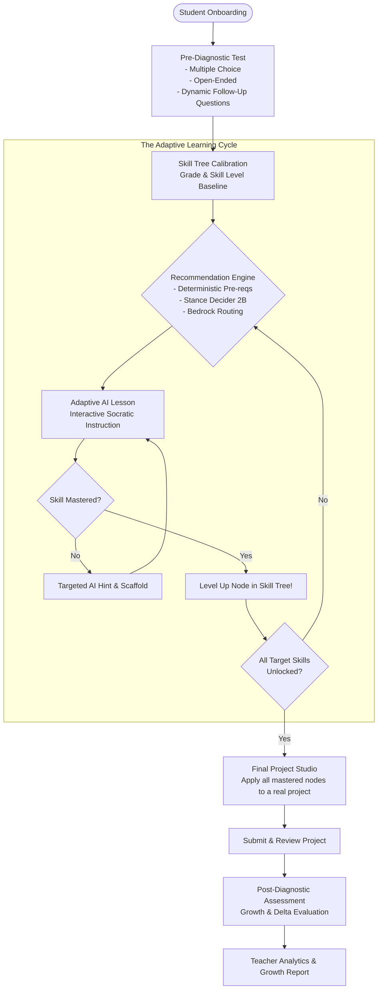

# Project Specification: CodeAI Adaptive Learning Engine
*A Gamified Skill-Tree & Routing Platform for AP Computer Science Principles & K-12 Classrooms*

---

## 🎯 1. Executive Summary & Goals

### 1.1 Goal
Build an intelligent, personalized learning engine designed for K-12 students learning to code and build real-world software projects, regardless of starting skill level. The platform serves as a **primary classroom copilot for teachers** (tailored to AP Computer Science Principles and foundational computing), tracking mastery, personalizing lessons, and verifying growth.

### 1.2 Core Pillars
1. **Holistic Diagnostic Profiling**: Evaluates prior knowledge, school grade, and cognitive coding readiness through dynamic multiple-choice, open-ended conceptual explanations, and automated follow-up questioning.
2. **Gamified Skill-Tree Mastery & Poly-Hierarchy**: Represents curriculum progress as an interactive node graph (like an RPG skill tree). Skills can belong to multiple categories (e.g. `While Loops` belongs to both `Conditionals / Boolean Logic` and `Iteration / Loops`).
3. **Deterministic & Stance Decider 2B Routing**: Combines strict prerequisite logic trees with a 2B SLM (Stance Decider 2B) and Amazon Bedrock to decide the optimal next learning step, project branch, or remediation path.
4. **Project-Based Culmination**: Students don't just solve isolated puzzles—they synthesize their unlocked node skills into an end-to-end final project.
5. **Post-Project Growth Diagnostics**: Compares pre- and post-project diagnostic metrics across individual sub-skills to quantify actual student learning gains for teachers.

---

## 🛠️ 2. Official Production Tech Stack (CodeAI / AWS Imagine Grant)

Derived from the official CodeAI AWS Imagine Grant technical environment:

| Layer | Technology | Role |
|---|---|---|
| **Application & Backend** | **Ruby 3.2 / Ruby on Rails 7.1** *(Python permitted for routing/ML)* | Application tier, `AdaptiveLevel` routing engine, validation services |
| **Frontend / Student UI** | **React 18, TypeScript, MUI 7** | Student-facing adaptive lesson UI, responsive skill tree graph |
| **Database (System of Record)** | **Amazon Aurora (SQL)** | Curriculum definitions, `UserLevel` progress records, sections, skill trees |
| **State & Cache** | **Amazon SimpleDB / DynamoDB / ElastiCache** | Fast routing flags, session caches, transient quiz state |
| **AI & LLM Services** | **Amazon Bedrock (Flexible Model Abstraction)** | Socratic hint generation, diagnostic evaluation, rubric grading |
| **SLM Routing** | **Stance Decider 2B** | Lightweight routing classifier for student learning stances |
| **Evaluation & Observability** | **Langfuse & Bedrock Evals** | Model scoring, prompt latency, curriculum rubric compliance |
| **Cloud Hosting** | **AWS (Serverless / Containers)** | Native AWS cloud deployment |

---

## 🧭 3. High-Level Architecture & Flow

---

## 🔬 4. Detailed Component Breakdown

### 4.1 Adaptive Diagnostic Engine & Evaluation Modalities
- **Evaluation Modality (Check Answers)**:
  - Used during diagnostics, quizzes, and checkpoint assessments.
  - Checks student answers, code syntax, and reasoning against curriculum benchmarks and rubric criteria.
- **Lesson Modality (Live Feed Telemetry)**:
  - Inspired by Code.org's `UserLevel` and student level data tracking.
  - In lesson mode, the AI monitors the **live code feed** (live keystrokes, compilation errors, execution attempts, idle time) to provide proactive Socratic guidance before the student experiences cognitive frustration.
- **Pre-Diagnostic**:
  - **Demographics & Profile**: Grade level (K-12), previous coding exposure (Scratch, Python, None, etc.), target project interests.
  - **Tri-Modal Assessment**:
    1. *Multiple Choice*: Measures syntactic and structural knowledge.
    2. *Open-Ended*: Tests conceptual understanding (e.g., *"Explain what a variable is in your own words"*).
    3. *Dynamic AI Follow-Up*: Bedrock prompts deeper based on student responses to probe whether they understand edge cases or had lucky guesses.
- **Post-Diagnostic & Optional Reteach Loop**:
  - Administered immediately after the final project.
  - Generates delta analytics: $[ \Delta \text{Skill} = \text{Score}_{\text{post}} - \text{Score}_{\text{pre}} ]$.
  - **Optional Post-Project Reteach**: If the post-diagnostic detects regression or remaining gaps on specific topics, the platform offers an explicit **AI Reteach Loop** allowing students to revisit focused micro-lessons and reinforce weak nodes before course sign-off.
  - Generates concrete proof-of-growth reports for educators on the teacher dashboard.

### 4.2 Backend Skill Tree Architecture, Curriculum Database & Point Classification
- **Backend-First State Machine & Curriculum Database**:
  - Leverages the teammate's **Curriculum Database** (anchored by curriculum database/CSTA_2026_PK12_Standards_by_Grade.xlsx in Amazon Aurora SQL / SimpleDB) defining all AP CSP concepts, standards, competencies, and question banks.
  - The skill tree is strictly maintained, evaluated, and resolved on the **backend tier** (Ruby on Rails / Python services backed by Aurora SQL and SimpleDB/DynamoDB caches).
  - The frontend is a lightweight display consumer that renders the state received from backend endpoints (e.g., `GET /api/v1/student/skill_tree`).
- **Point Classification Model**:
  - Every skill node has an associated vector of mastery points:
    $$P_{\text{node}} = \{ \text{conceptual\_score}, \text{syntax\_score}, \text{problem\_solving\_score} \}$$
  - Assessment answers (MCQs, code submissions, open-ended responses) award calibrated points across multiple relevant nodes simultaneously.
  - **Prerequisite Thresholds**: A node transitions from `LOCKED` $\to$ `AVAILABLE` when all inbound prerequisite parent nodes exceed their minimum point threshold ($P_{\text{parent}} \ge \theta_{\text{unlock}}$).
- **Poly-Hierarchy / Dual Category Routing**:
  - Nodes like **While Loops** belong to both `Conditionals` and `Iteration`. 
  - The backend routing evaluator calculates whether the combined conditional mastery points and looping readiness meet the threshold before unlocking while loop lessons or challenges.

### 4.3 Next Step Recommendation: Point Classification + Stance Decider 2B
The next learning step (whether to give a question, a mini-lesson, a remediation hint, or a project synthesis challenge) is generated through a two-stage hybrid pipeline:
1. **Deterministic Stage (Point & DAG Classifier)**:
   - Scans the graph for candidate nodes that are unlocked but not yet mastered.
   - Evaluates current point deficits: where does the student have the largest gap relative to their target project skills?
2. **Dynamic Stage (Stance Decider 2B + Bedrock)**:
   - Takes the top deterministic candidate nodes, student response latency, recent mistake patterns, and qualitative diagnostic inputs.
   - **Stance Decider 2B** outputs a discrete pedagogical stance:
     - `STANCE_REINFORCE`: Student has borderline points; serve targeted diagnostic follow-up question.
     - `STANCE_ADVANCE`: Student demonstrated decisive point surplus; advance to next topological skill node.
     - `STANCE_BRIDGE`: Student mastered two disparate branches; recommend a cross-cutting challenge (e.g. while loops + list filtering).
     - `STANCE_PROJECT_SYNTHESIS`: Prerequisite point threshold reached for final project module.

### 4.4 Final Project & Teacher Primary Resource Integration
- **Teacher Tools**:
  - Live classroom monitoring: see which students are stuck on specific nodes (`UserLevel` progress views).
  - Standards mapping to AP CSP Big Ideas (Creative Development, Data, Algorithms & Programming, Computer Systems/Networks, Impact of Computing).
- **Final Project Studio**:
  - Scaffolded workspace where students build games, simulations, or interactive tools using the exact set of skills unlocked on their tree.

---

## 🗺️ 5. Project Roadmap

| Phase | Milestone | Deliverables | Target Status |
|---|---|---|---|
| **Phase 1** | **Diagnostic & Architecture Scaffold** | Diagnostic schema, tri-modal question generator, `collab.md` operational flow | 🟡 In Progress |
| **Phase 2** | **Skill Tree Engine & Graph Logic** | DAG node schema (supporting poly-hierarchy), deterministic pre-req evaluator, tree state visualizer | ⚪ Upcoming |
| **Phase 3** | **Stance Decider 2B & Bedrock Lesson AI** | Bedrock wrapper (model abstraction), SLM inference for routing, interactive Socratic tutor | ⚪ Upcoming |
| **Phase 4** | **Project Studio & AP CSP Content** | AP CSP curriculum nodes, final project builder templates | ⚪ Upcoming |
| **Phase 5** | **Post-Diagnostic & Teacher Dashboard** | Growth delta calculation engine, classroom mastery overview | ⚪ Upcoming |
