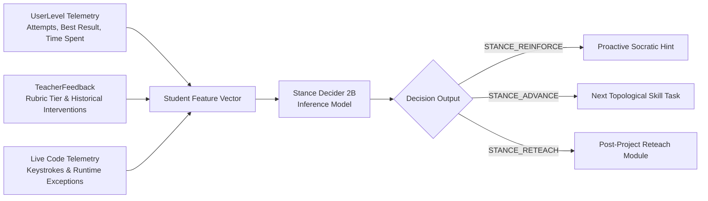

# Code.org Reference Architecture & Production Schema Patterns

> **Upstream Repository:** `https://github.com/code-dot-org/code-dot-org`  
> **Application Layer:** `dashboard/app/models/` (Ruby on Rails 7.1)  
> **Purpose:** Foundational blueprint for persistence, AWS integrations (S3/Aurora/ElastiCache), telemetry tracking, teacher feedback, and retention models for the CodeAI Adaptive Learning Engine.

---

## 🏗️ 1. Core Production Models & Schema Architecture

In Code.org's production Rails architecture, the tracking of student progress, attempts, feedback, and telemetry revolves around specific relational models:

### 1.1 `UserLevel` (`dashboard/app/models/user_level.rb`)
- **Role:** The primary join model between a student (`user_id`) and a specific task/puzzle (`level_id`).
- **Core Attributes & Schema Fields:**
  - `user_id` (integer, indexed)
  - `level_id` (integer, indexed)
  - `script_id` / `unit_id` (contextual course/unit pointer)
  - `attempts` (integer counter of submission runs)
  - `best_result` (integer enum representing test pass, partial pass, or failing test)
  - `time_spent` (cumulative interaction time on level)
  - `unlocked` (boolean flag)
  - `level_source_id` / `s3_source_url` (reference to student's saved code)
  - `updated_at` (telemetry timestamp for retention and last activity)
- **Relevance to Adaptive Engine:**
  - The Adaptive Engine extends `UserLevel` into `AdaptiveUserLevel`, storing the calculated node point vector ($P_{\text{node}} = \{\text{concepts, syntax, problem\_solving}\}$), current difficulty stage (0–3), and the routing path taken.

### 1.2 `TeacherFeedback` (`dashboard/app/models/teacher_feedback.rb`)
- **Role:** Stores qualitative commentary, rubric scores, and review signals from educators.
- **Core Attributes & Schema Fields:**
  - `teacher_id` (reference to instructor)
  - `student_id` (reference to learner)
  - `level_id` / `script_id`
  - `comment` (qualitative advice/encouragement)
  - `performance` (rubric tier, e.g. `needs_work`, `meets_standard`, `exceeds_standard`)
  - `review_state` (`keep_working`, `completed`)
- **Relevance to Adaptive Engine:**
  - In our architecture, both human teachers and the AI Bedrock evaluator write to `TeacherFeedback` to provide synchronized rubric scores and formative hints.

### 1.3 `Activity` & `LevelSource` (`dashboard/app/models/activity.rb`, `level_source.rb`)
- **Role:** Immutable audit log of every run/test attempt by a student.
- **Attributes:**
  - `data` / `code`: Student source code snapshot.
  - `result`: Test suite execution status.
  - `test_result`: Granular unit test assertions.

---

## ☁️ 2. AWS Integration Patterns in Code.org

1. **Amazon Aurora (SQL Database)**:
   - Houses the normalized relational schema (`users`, `user_levels`, `levels`, `scripts`, `teacher_feedbacks`, `sections`).
   - High-throughput read replicas are used for dashboard analytics, leaving write paths dedicated to real-time student submissions.
2. **Amazon S3 (Object Storage)**:
   - Stores large student project artifacts, multi-file code workspaces, starter assets, and rubric export archives (`s3://code-dot-org-sources/...`).
   - Student submissions generate hashed S3 keys referenced in `level_sources`.
3. **Amazon ElastiCache / Redis & DynamoDB / SimpleDB**:
   - Caches active classroom sessions, section rosters, and transient routing flags (`adaptive.json` state machines) to keep student level loading under 100ms.
4. **Amazon Bedrock & AI Services**:
   - Integrated via the `aws-sdk-ruby` gem within Rails service objects (e.g. `app/services/bedrock_evaluator.rb` and `app/services/stance_decider_service.rb`).

---

## 🔄 3. Adaptive Decision & Retention Model

The combination of `UserLevel` telemetry + `TeacherFeedback` histories feeds directly into our **Stance Decider 2B & Bedrock Routing Engine**:

